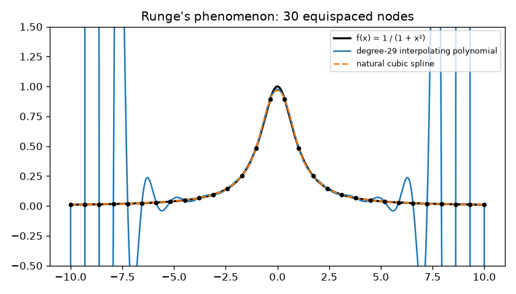
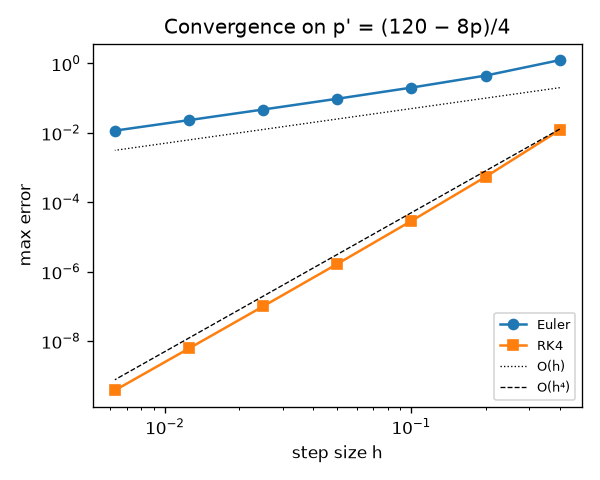
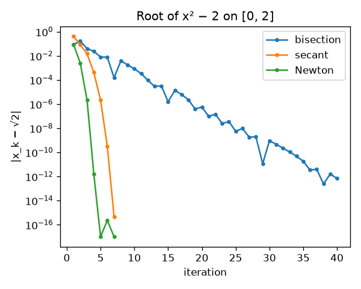

# numerical-methods-python

Classical numerical methods implemented with NumPy, tested against SciPy: polynomial interpolation, cubic splines, ODE solvers, root finding, and the binary representation of real numbers.

The code comes from my Numerical Methods coursework at ICAI. Function names and comments are kept in Spanish, as I originally wrote them.

## Contents

| Module | Functions | Method |
|---|---|---|
| `interpolation` | `newton_formula`, `polynomial_newton`, `build_interpolator_newton` | Newton divided differences, evaluated with nested multiplication (Horner-type) |
| `spline` | `spline` | Natural cubic spline: tridiagonal system for the second derivatives (moments) M₀…Mₙ with M₀ = Mₙ = 0 |
| `ode` | `euler`, `Runge4` | Explicit Euler and classical 4th-order Runge–Kutta for y' = f(x, y) |
| `root_finding` | `biseccion`, `secante`, `newton` | Bisection, secant and Newton–Raphson, with a fixed number of iterations `n` and an optional tolerance `tol` |
| `floating_point` | `convertir_binario` | Binary expansion of a real number (integer part plus up to 24 fractional bits) |

## Results

All numbers below come from `examples/make_figures.py`.

**Runge's phenomenon.** f(x) = 1/(1 + x²) is interpolated on 30 equispaced nodes in [−10, 10]:

- The degree-29 polynomial oscillates wildly near the ends of the interval. Its maximum error is 5.4·10³.
- The natural cubic spline through the same nodes stays within 3.5·10⁻².

Interpolating |x| on [−1, 1] with n = 5, 10, 15 and 20 equispaced intervals, the maximum error goes from 0.14 (n = 5) to 95 (n = 20). Adding equispaced nodes makes things worse, not better.



**Order of convergence of the ODE solvers.** The test problem is a price adjustment model, p'(t) = (120 − 8p)/4 with p(0) = 20 on [0, 4], whose exact solution is p(t) = 5e^(−2t) + 15. The step is halved from n = 10 to n = 640 steps:

| Method | Max error (n = 640) | Observed order |
|---|---|---|
| Euler | 1.2·10⁻² | 1.03 |
| Runge–Kutta 4 | 3.8·10⁻¹⁰ | 4.05 |

Both match the theoretical orders of 1 and 4.



**Root finding for x² − 2 on [0, 2].** The table shows how many iterations each method needs before the error first drops below 10⁻¹²:

| Method | Iterations | Convergence |
|---|---|---|
| Bisection | 38 | linear: the interval halves each step |
| Secant | 7 | superlinear (theoretical order ≈ 1.62) |
| Newton (x₀ = 2) | 5 | quadratic (theoretical order 2) |



The three methods take a maximum number of iterations `n` and an optional tolerance `tol`. Without `tol` they always run `n` iterations. With `tol` they stop once the step, or the half-width of the bracket for bisection, falls below it. The secant method shows why the tolerance matters: with `n = 20` and no tolerance it keeps iterating after convergence, reaches f(xₘ) = f(xₙ) and raises an error.

**Floating point.** `convertir_binario(0.1)` gives `0.000110011001100110011001`, a periodic expansion that has to be truncated, which is why 0.1 cannot be stored exactly in binary. `convertir_binario(0.625)` gives exactly `0.101`.

## Tests

`pytest` runs 21 tests:

- The spline matches `scipy.interpolate.CubicSpline` (natural boundary conditions).
- The Newton interpolant matches `scipy.interpolate.KroghInterpolator`.
- RK4 matches `scipy.integrate.solve_ivp`.
- The observed convergence orders of Euler and RK4 are 1 and 4 on a logistic equation.
- There are checks on the root finders, with and without tolerance, and on the binary expansion.

## Corrections relative to the original code

- `convertir_binario` did not subtract 1 after writing a 1 bit, so from the first 1 onwards it only produced zeros. For 0.1 it returned `0.0.000100…`. It also wrote the integer part in decimal and as a float. Both are fixed.
- The root finders gained the optional `tol` argument. With `tol=None` (the default) their behaviour is unchanged.

## How to run

```bash
pip install -e ".[dev]"
pytest
python examples/make_figures.py
```
